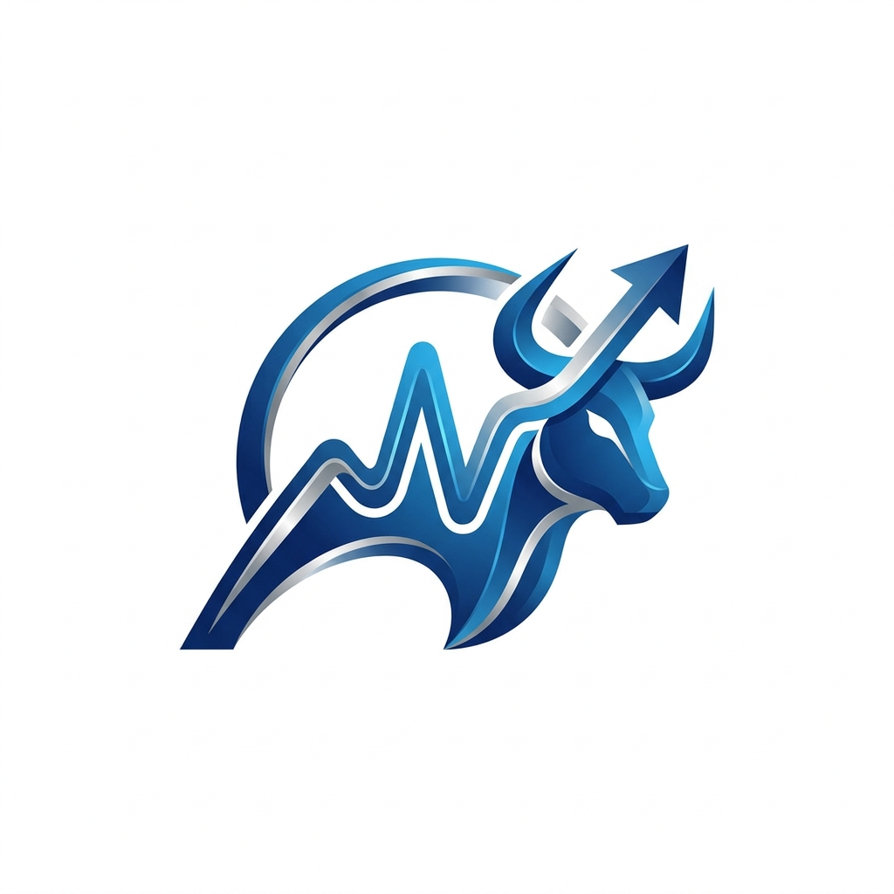

#  AI-Vibe-Trader

<p align="center">
  <a href="https://github.com/MS-Song/ai-tradding/actions/workflows/release.yml">
    
  </a>
  
  
  
  
  <a href="https://github.com/MS-Song/ai-tradding/releases">
    
  </a>
</p>

> **"단순한 매매가 아닙니다. 시장의 흐름(Vibe)을 읽는 AI 자율 트레이딩 엔진입니다."**
> AI-Vibe-Trader는 시니어 아키텍트의 설계 사상이 반영된 객체지향형 트레이딩 시스템으로, 시장 감성(Vibe)과 AI 분석(Gemini/Groq)을 결합하여 최적의 매매 전략을 자율적으로 도출합니다.

---

## 🌌 Overview (프로젝트 소개)

**AI-Vibe-Trader**는 단순한 자동 매매 프로그램을 넘어, **시니어 아키텍트의 설계 사상**이 반영된 객체지향형 자율 트레이딩 엔진입니다. 

기존의 단순 지표 기반 트레이딩에서 벗어나, 시장 전체의 감성(Vibe)을 입체적으로 분석하고 Google Gemini와 Groq의 최첨단 AI 통찰을 결합하여 **"지키는 투자"**와 **"수익 극대화"** 사이의 완벽한 균형을 추구합니다.

### 🎯 핵심 가치
- **Contextual Awareness**: 가격 데이터만 보는 것이 아니라, 뉴스, 수급, 거시 지표(환율, 나스닥 등)를 통해 시장의 '분위기'를 읽습니다.
- **Architectural Excellence**: 7대 핵심 모듈(`Exit`, `Market`, `Recovery`, `Pyramiding`, `Alpha`, `Preset`, `Retrospective`)이 유기적으로 협력하는 견고한 아키텍처를 가집니다.
- **Dual Broker Support**: **한국투자증권(KIS)**과 **키움증권(Kiwoom)**을 동시에 완벽 지원합니다.
- **Proactive Risk Management**: 복기 빅데이터에 기반한 5대 손해 축소 전략과 하위 종목 수수료 누수 차단 5대 대책으로 계좌를 철통 방어합니다.

---

## 🛠️ Core Trading Algorithm (트레이딩 알고리즘)

본 엔진은 다층적인 의사결정 프로세스를 통해 매매를 집행합니다.

### 1. Market Vibe Detection (장세 진단)
매초 단위로 나스닥 선물, 코스피/코스닥 지수, 달러 환율, 비트코인 프리미엄 등을 수집하여 시장을 4가지 상태로 정의합니다.
- **BULL**: 공격적 투자, 적극적 불타기 허용
- **NEUTRAL**: 표준 전략 유지
- **BEAR**: 현금 비중 확대(30%), 물타기 간격 확대, 음봉 낙주 배제
- **DEFENSIVE**: 최우량주 1종목 집중 또는 전량 현금화(80%), SL 즉각 청산

### 2. Vibe-Alpha Selection (AI 종목 발굴)
네이버 금융 모바일 공식 JSON API의 실시간 랭킹 데이터와 개별 종목의 펀더멘털(PER, PBR, 배당), 일봉/분봉 MA 및 수급을 결합하여 Quant 스코어를 산출합니다. 이후 Gemini/Groq AI가 최신 뉴스와 모멘텀을 2차 검증하여 최종 추천 리스트를 생성합니다.

### 3. Dynamic Strategy Execution & Risk Defense (동적 전략 및 방어)
- **동적 TP/SL**: Vibe 및 시간대별 Phase(Offensive/Convergence/Conclusion/Preparation)에 따른 실시간 교정.
- **5대 손해 축소 전략**: 오프닝 갭 가드(09:00~09:20 동결), 단일 종목 Hard Cap(10%/800만원), 당일 2회 손절 락, 수익 보존 트레일링 스탑, 음봉 낙주 필터.
- **수수료 누수 방어**: SL Guard 안전마진(-2.5% 강제), 신규 매수 초기 10분 호가 보호, 자투리 1주 매매(Dust) 금지, 최소 거래대금 30억 필터, 교체 매매 3회 상한.

---

## 🚀 Quick Start (시작하기)

### 📋 준비물
1. **증권사 API 키**: 한국투자증권(KIS) 또는 키움증권(Kiwoom) 앱키/시크릿
2. **AI API 키**: Google Gemini (필수) 및 Groq (선택/Fail-over용)

### 💻 실행 방법

#### 1. EXE 실행 (일반 사용자)
- [Releases](https://github.com/MS-Song/ai-tradding/releases) 페이지에서 최신 버전의 `AI-Vibe-Trader.exe`를 다운로드하여 즉시 실행 가능합니다.

#### 2. 소스 코드 실행 (개발자)
```bash
# 레포지토리 클론
git clone https://github.com/MS-Song/ai-tradding.git

# 의존성 설치
pip install -r requirements.txt

# 프로그램 실행
python main.py
```

#### 3. Docker 컨테이너 실행
```bash
./docker_build.sh && ./docker_run.sh
```

---

## 🏗️ System Pillars (7대 핵심 엔진)

| 모듈 | 역할 |
| :--- | :--- |
| **MarketAnalyzer** | 글로벌 지수 및 거시 지표 기반 시장 분위기(Vibe) 및 지수 DEMA 판정 |
| **VibeAlphaEngine** | 퀀트 + 공식 JSON API + AI 분석을 통한 주도주 발굴 및 스코어링 |
| **ExitManager** | 장세와 Phase에 따른 동적 TP/SL 산출, SL Guard 및 트레일링 스탑 |
| **RecoveryEngine** | 하락 구간에서의 평단가 관리 및 지능적 물타기 수행 |
| **PyramidingEngine** | 상승 추세 종목의 비중 확대를 통한 수익 극대화(불타기) |
| **PresetStrategyEngine** | KIS 10대 공식 전략 기반 종목별 최적 매매 로직 할당 |
| **RetrospectiveEngine** | 장 마감 후 당일 매매 성과 사후 복기 및 일일 종합 통계 영속화 |

---

## 🛠️ Tech Stack (기술 스택)

- **API Integration**: 한국투자증권(KIS), 키움증권(Kiwoom), Naver Finance JSON API, Google Gemini, Groq
- **Language**: Python 3.12+
- **Automation**: GitHub Actions (Windows EXE 및 Docker Hub 자동 배포)
- **Container**: Docker (Linux / Windows)

---

## 📄 Documentation (관련 문서 맵)

| 문서 | 설명 |
| :--- | :--- |
| [📈 TRADING_RULES.md](docs/TRADING_RULES.md) | **[코어 매매 규칙]** 동적 TP/SL, 물타기/불타기, 5대 손해 축소 및 수수료 방어 규칙 |
| [🏗️ SYSTEM_ARCH.md](docs/SYSTEM_ARCH.md) | **[시스템 아키텍처]** 7대 코어 모듈 구조, 데이터 흐름, 듀얼 브로커 설계 |
| [🌳 LOGIC_TREE.md](docs/LOGIC_TREE.md) | **[의사결정 분기 트리]** 세부 알고리즘 로직 및 유지보수 히스토리 |
| [📖 USER_MANUAL.md](docs/USER_MANUAL.md) | **[사용자 매뉴얼]** TUI 화면 인터페이스, 전체 단축키 및 설정 가이드 |
| [🛡️ vibe_guard_manual.md](docs/vibe_guard_manual.md) | **[리스크 가이드]** 3중 방어 메커니즘 및 과도매매 가드 상세 |
| [🐳 DEPLOYMENT_GUIDE.md](docs/DEPLOYMENT_GUIDE.md) | **[도커/배포 가이드]** Docker 컨테이너 및 CI/CD 자동화 배포 가이드 |
| [📋 PROGRAM_SPECIFICATIONS.md](docs/PROGRAM_SPECIFICATIONS.md) | **[프로그램 명세서]** 전수 파이썬 소스 파일 상세 명세 |
| [🔌 API_INTEGRATION.md](docs/API_INTEGRATION.md) | **[API 명세]** KIS 및 Kiwoom 증권사 API 연동 규격 |
| [✅ TEST_SCENARIOS.md](docs/TEST_SCENARIOS.md) | **[테스트 시나리오]** 64종 통합/단위 테스트 명세 |
| [📊 TEST_REPORT.md](docs/TEST_REPORT.md) | **[검증 리포트]** 64종 테스트 100% 통과 검증 보고서 |

---

## 🛡️ License & Disclaimer

- 본 프로젝트는 **MIT License**에 따라 배포됩니다.
- **주의**: 본 프로그램은 투자 판단의 보조 도구일 뿐입니다. 모든 투자에 대한 최종 책임은 사용자 본인에게 있으며, 시장 변동성에 따른 손실에 대해 개발자는 책임을 지지 않습니다.

---
<p align="right">Developed & Maintained by <b>MS-Song</b></p>
