# 🌲 AI-Vibe-Trader Logic Tree & Checklist (v2.4.261011)

이 문서는 시스템의 모든 기능 단위(자동/수동)를 정의하고, Docstring 기반의 표준 명세와 테스트 코드가 커버해야 할 특정 조건을 기술합니다.

## 1. System Architecture & Flow Tree

```mermaid
graph TD
    %% [Core Flow]
    Main[VibeStrategy.run_cycle] --> Init[1. 초기화 및 환경 진단]
    Init --> MarketStat[MarketAnalyzer: 시장 개장/휴장/패닉 여부 진단]
    Init --> VibeDetect[MarketAnalyzer: VIBE 판정 - Bull/Bear/Defensive]
    Init --> RiskCheck[RiskManager: 서킷 브레이커 및 현금 비중 체크]

    %% [Command & UI Units - Manual Control]
    Main --> UI_Command[2. 사용자 커맨드 처리 - Interaction]
    UI_Command --> Reports[조회 리포트: B/D/H/P/A/L]
    UI_Command --> Manual_Trade[직접 매매: 1-매도 / 2-매수]
    UI_Command --> Manual_Config[임계치 수정: 3-TP/SL 수정]
    UI_Command --> Engine_Config[엔진 설정: 4-AI / 5-물타기 / 6-불타기]
    UI_Command --> AI_Manual[AI 수동 제어: 8-즉시 분석 / 9-전략 할당 / 7-종목 분석]

    %% [Holding Management]
    Main --> HoldingProc[3. 보유 종목 프로세싱 - ExitManager]
    HoldingProc --> PhaseCorrection[Phase별 TP/SL 보정 - P1~P4]
    HoldingProc --> GapGuard_SL[오프닝 갭 가드: 09:00~09:15 SL 1.0% 완화 버퍼]
    HoldingProc --> TrailingStop[트레일링 스탑: +3% 도달 후 고점 대비 -1%p 밀림 시 이익 보존]
    HoldingProc --> DynamicExit[실시간 익절/손절 감시]
    DynamicExit --> EmergencyExit[긴급 탈출: 패닉/Defensive 전환/급락]
    DynamicExit --> PartialExit[수익 확정: 분할 매도 및 쿨다운]
    HoldingProc --> Phase4_Exit[Phase 4: 장 마감 전 AI 통합 배치 리뷰/정리]

    %% [Entry Engine]
    Main --> EntryEngine[4. 매수 엔진 - Entry/Recovery/Pyramiding]
    EntryEngine --> GapGuard_Buy[오프닝 갭 가드: 09:00~09:20 신규 매수 동결]
    EntryEngine --> TickerLock[당일 동일 종목 2회 손절 락: 당일 재진입 전면 금지]
    EntryEngine --> FallingKnife[Bear/Neutral 역배열 음봉 낙주 진입 차단]
    EntryEngine --> HardCap[Hard Cap: 총자산 10% / 최대 800만원 단일 종목 한도]
    EntryEngine --> AI_Buy[AI 자율 매수: 신규 진입/종목 교체]
    AI_Buy --> AI_Confirm[VibeAlphaEngine: 상투 방어/BUY_ZONE 체크]
    EntryEngine --> Recovery[Recovery Engine: 물타기 - 하락 대응]
    EntryEngine --> Pyramiding[Pyramiding Engine: 불타기 - 상승 추종]

    %% [Infrastructure]
    Main --> Infra[5. 인프라 및 로깅]
    Infra --> RateLimiter[BaseAPI: 중앙 집중식 Token Bucket Rate Limiting]
    Infra --> StateSync[DataManager: trading_state.json 실시간 동기화]
    Infra --> PnLSync[SyncWorker: 보유 종목 전수 합산 기반 일일 평가액 보정]
    Infra --> Logger[TradingLogManager: JSON/텍스트 로그 및 텔레그램 알림]
    Infra --> DockerTrigger[updater.py: Docker 자동 업데이트 감지 및 update_trigger 생성]
    DockerTrigger --> HostMonitor[docker_update_monitor.sh/.ps1: 호스트에서 트리거 감지 및 git pull/docker compose restart 실행]
```

---

## 2. Functional Unit Specification (Docstring Based)

### 🛰️ Market Analyzer & Risk Manager
- **장세 판단**: KOSPI/KOSDAQ 지수와 DEMA(20)의 이격도를 분석하여 Bull/Bear/Defensive 판정.
- **패닉 차단**: 글로벌 지수(NASDAQ 등) 급락 시 `is_panic=True`로 모든 신규 매수 원천 차단.
- **현금 보호**: Vibe별 최소 현금 비중(Bear 30%, Defensive 80%) 미달 시 매수 엔진 비활성화.
- **멀티 브로커 [v2.0]**: KIS 및 Kiwoom API 통합 지원. 중앙 집중식 Rate Limiter를 통한 API 안정성 확보.

### 🛡️ Exit Manager (Exit Strategy)
- **가변 임계치**: Vibe와 Phase(P1~P4)를 결합하여 실시간 TP/SL 보정.
- **오프닝 갭 가드 [v2.4]**: 09:00~09:15 동안 보유 종목 SL에 +1.0% 완화 버퍼를 부여하여 시초가 갭 흔들기 휩쏘에 의한 기계적 바닥 털림 방지.
- **트레일링 스탑 [v2.4]**: 수익률 +3.0% 돌파 종목은 기계적 조기 익절을 방지하고, 최고 수익률 대비 1.0%p 하락 시 전량 청산하여 손익비(R/R) 극대화.
- **수동 매수 보호 [v1.6.8]**: 사용자가 직접 매수한 종목은 20분 동안 AI 자율 분석에 의한 청산에서 보호됨. (단, 손절선 돌파 시에는 즉시 매도)
- **시스템 시작 보호 [v2.1]**: 프로그램 시작 후 10~20분 동안 기존 보유 종목에 대한 자동 손절/익절 유예 (Startup Grace Period).
- **0 설정 비활성화 [v2.1]**: TP/SL이 0.0으로 설정된 경우 모든 보정을 중단하고 매매 대상에서 제외.
- **쿨다운 관리**: 익절 후 1시간 동안 재익절 제한 (불타기 시 리셋).
- **긴급 청산**: 수익률이 보정된 TP보다 3% 이상 높거나 거래량 폭발 시 즉시 탈출.

### 🚀 Entry Engines (AI/Recovery/Pyramiding)
- **오프닝 갭 가드 [v2.4]**: 전체 손실의 44.7%가 집중된 09:00~09:20 구간 동안 신규 AI 자율 매수를 전면 동결(관망).
- **Hard Cap 포지션 사이징 [v2.4]**: RiskManager를 통해 단일 종목 투자금을 총 자산의 10% 또는 최대 800만원으로 엄격히 제한(몰빵 방지).
- **당일 동일 종목 2회 손절 락 [v2.4]**: 1회 손절 시 3시간 쿨다운, 당일 2회 손절 시 15:30까지 당일 재진입 전면 차단.
- **하락장 역배열 낙주 필터 [v2.4]**: Bear/Neutral 장세 시 20일 이동평균선 아래에 있거나 음봉인 낙주 종목은 자동 매수에서 원천 제외.
- **VibeAlphaEngine**: 뉴스, 펀더멘털, 기술적 지표, **수급(스마트 머니) 사이클**을 결합한 100점 만점 퀀트 스코어링.
    - **수급 2중화 [v1.6.8]**: Naver(상세 이력) 우선 수집 후 KIS(연기금/실시간) 보완 체계로 데이터 신뢰도 극대화.
    - **[신규] AI 추천 필터 강화**: 시가총액 **1000억 미만** 초소형주 및 **ETF(레버리지/인버스 포함)**를 추천 후보군에서 원천 제외하여 개별 우량주 중심의 포트폴리오를 구성함.
    - **수급 사이클 가점 [v1.6.8]**: 단순 당일 매수가 아닌 최근 10일간의 '매집(Accumulation) -> 가속(Acceleration)' 사이클을 분석하여 상승 초입 종목 포착.
- **Recovery Engine**: 손절선 직전에서 평단가를 낮추는 물타기 로직. (직전 물타기 대비 -2% 조건)
- **Pyramiding Engine**: 상승 추세에서 비중을 확대하는 불타기 로직. (수익률 3% 이상 & 상승장)

---

## 3. Test Coverage (v2.0.260518)

### ✅ [T-01] 인프라 및 연결성 테스트
- [x] **`tests/test_kis_price.py`**: KIS 시세 조회 API 응답성 및 도메인 정합성 확인.
- [x] **`tests/test_kiwoom_api.py`**: Kiwoom REST API 인증 및 잔고 조회 확인.
- [x] **`tests/test_naver_api.py`**: 네이버 환율 및 지수 데이터 수집 확인.
- [x] **`tests/verify_gemini_api.py`**: 멀티 LLM(Gemini/Groq) 통신 및 모델 리스트 확인.

### ✅ [T-02] 데이터 수집 및 가공
- [x] **`tests/test_naver_ranking.py`**: 인기/거래량 종목 데이터 무결성 및 필터링 확인.

### ✅ [T-03] 핵심 로직 통합 테스트
- [x] **`tests/test_advanced_integration.py`**:
    - [x] 수동 매매 및 임계치 수정 시나리오.
    - [x] 물타기/불타기 트리거 및 현금 보호 로직.
    - [x] 장 마감(P3/P4) 수익 확정 및 AI 종목 교체 매매.
    - [x] 상투 매수 방어 및 0원 데이터 보호.

---

## 4. Maintenance Notes (2026-05-08)
- **문서화**: 전 모듈 Google 스타일 Docstring 적용 및 타입 힌트 표준화 완료.
- **로직 강화 [2026-05-08]**: 장 초반(09:00~09:20) 지수 Vibe 연동형 '안정화 필터' 도입으로 승률 최적화.
- **테스트**: KIS 랭킹 테스트를 시세 조회(`test_kis_price.py`)로 명확히 분리 및 통합 완료.
- **로직 강화 [2026-05-08]**: Defensive/BEAR 장세에서 손절선이 양수로 전환되어 조기 청산되는 버그를 방지하기 위한 **SL Guard (-1.0% 상한선)** 도입.
- **UI 최적화 [2026-05-08]**: AI 로그 및 추천 탭의 컬럼 너비 동적 확장 및 텍스트 생략(...) 로직 적용으로 시인성 개선.
- **UI 가시성 개선 [2026-05-15]**: AI 분석 중 추천 종목 리스트 및 시황 브리핑이 사라지는 'Flicker' 현상 해결. 분석 완료 전까지 기존 데이터를 유지하고 완료 후 Atomic Swap으로 교체하는 로직 적용.
- **Python 3.14+ 로깅 호환성 대응 [2026-05-18]**: Python 3.14+ 버전에서 `logging.Formatter.converter`가 bound method 형태로 호출될 때 발생하는 `TypeError: kst_converter() takes 1 positional argument but 2 were given` 오류를 가변 인자(*args) 지원 방식으로 대응 및 수정 완료.
- **통합 테스트 견고화 [2026-05-18]**: `MockStrategy` 가 부팅될 때 시스템 초기 보호(Startup Grace Period)에 의해 익절/손절 테스트가 유예되는 이슈를 해결하기 위해 `boot_time`을 충분한 과거 시간으로 수정하여 `test_tc_a02_pyramiding_trigger` 및 `test_tc_a05_emergency_bypass` 테스트가 정상 통과하도록 복구.
- **키움증권 웹소켓 안정화 [2026-05-18]**: 키움 OpenAPI 웹소켓 서버가 데이터 송수신이 없거나 하트비트가 없을 때 10초 만에 연결을 강제 종료하는 Idle Timeout 현상을 해결하기 위해 `WS_KIWOOM` 워커의 주기(interval)를 기존 20.0초에서 **5.0초**로 대폭 단축하여 5초마다 JSON PINGPONG 하트비트 메시지를 강제 전송하도록 개선하고, 프로토콜 레벨의 불필요한 타임아웃 오작동을 차단하기 위해 `ping_timeout`을 `None`으로 설정함.
- **Docker 자동 업데이트 시스템 구축 [v2.3] [2026-05-18]**: Docker 환경 내에서 실시간 업데이트가 이루어질 수 있도록 볼륨 바인딩 기반의 `update_trigger` 메커니즘을 구축하였습니다. TUI 또는 텔레그램 업데이트 시그널 시 컨테이너가 트리거 파일에 신호를 주입하고 셀프 종료하면, 호스트에 상주하는 백그라운드 헬퍼 데몬(`docker_update_monitor.sh` / `.ps1`)이 이를 감지하여 안전하게 `git pull` 및 `docker compose rebuild`를 대신 집행하고 컨테이너를 정상 재가동함으로써, 보안상 치명적인 `docker.sock` 마운트 없이 완벽하게 격리된 이중 자동 업데이트(Watchtower 새벽 03:30 및 핫키 즉시 실행)를 완벽 지원합니다.
- **복기 리포트 기반 5대 손해 축소 엔진 탑재 [v2.4] [2026-10-11]**: 20거래일 복기 리포트(`trade_retrospective.json`) 분석 결과 확인된 5대 핵심 손실 요인(장초반 갭하락 노이즈 -44.7%, 단일종목 3천만원 몰빵, 손익비 0.47 왜곡, 당일 동일종목 반복 뇌동손절, 하락장 역배열 매수)을 완벽 차단하기 위해, (1) 09:00~09:20 오프닝 갭 가드(신규 매수 동결 + 09:00~09:15 SL 1.0% 버퍼), (2) 단일 종목 Hard Cap(총자산 10% / 800만원 한도), (3) 당일 동일 종목 2회 손절 락, (4) 손익비 개선 트레일링 스탑(+3% 돌파 후 고점 대비 -1%p 밀림 시 전량 청산), (5) Bear/Neutral 역배열 음봉 낙주 필터를 전격 탑재하고 100% 테스트 검증 완료.
- **하위 종목 수수료 누적 방지 및 조기 손절 휩쏘 차단 5대 대책 탑재 [v2.4.1] [2026-10-11]**: 복기 리포트의 TOP3에 가려져 있던 수많은 하위 종목들의 수수료 누수 및 조기 털림으로 인한 치명적 원금 잠식을 원천 차단하기 위해, (1) SL Guard 상한선 -2.5% 안전마진 강제 확보(호가 1~2틱 하락 및 수수료 0.3%에 의한 기계적 조기 손절 차단), (2) 신규 매수 초기 10분(600초) 호가 노이즈 손절 유예(단, -7% 급락 시 바이패스), (3) 자투리 1주 매매(Dust Trading) 전면 금지 및 최소 주문액 Floor(30만원) 적용, (4) 거래대금 30억원 미만 소외주 자동 매수 배제 필터, (5) 교체 매매 일일 3회 상한 및 복기 리포트 종합 통계(전체 수수료, 하위 종목 손익 합산) 전수 집계 탑재 완료.
- **AI 승인 후 매수 불가 시 5분 쿨타임 및 주문 정상 집행 보장 [v2.4.2] [2026-10-12]**: AI가 매수를 승인했으나 수량 부족(0주), 주문금액 미달, 주문 API 실패 등의 사유로 실제 주문을 넣지 못하거나 실패할 경우, (1) 구체적 사유를 AI 활동 로그(`trading_log.log_ai_activity`) 및 TUI에 명확히 기록하고, (2) `self.rejected_stocks[code]`에 5분(300초) 쿨타임을 등록하여 AI 컨펌 토큰이 무한 낭비되는 루프를 원천 차단함. (3) `execution.py` 내 `if qty <= 0:` 내부 들여쓰기 오류로 인해 정상 수량에서도 매수 주문 로직에 도달하지 못하던 치명적 결함을 완벽 수정하고 신규 통합 테스트 2종(`test_tc_i06`, `test_tc_i07`)을 포함한 총 66개 테스트 전수 통과 검증 완료.
- **신규 AI 매수 스캔 60초 스로틀링 및 낙주/시초가지지 차단 5분 쿨타임 최적화 [v2.4.3] [2026-10-13]**: 보유 종목 손익/손절 감시(1초 주기)는 유지하되, (1) 신규 종목 AI 자율 매수 스캔 주기를 60초(1분) 스로틀링(`buy_scan_interval`)하여 토큰 비용과 API 부하를 획기적으로 절감함. (2) `역배열 낙주 차단` 및 `시초가 지지선 필터` 발동 시 5분 쿨타임을 등록하고 루프 최상단에서 즉시 스킵하여 매초 로그 도배 및 네이버 시세 API 반복 호출을 원천 제거함. (3) 총 67개 단위/통합 테스트 전수 통과 완료.

---

## 5. NEXT_TASK (To-Do)
- [ ] **성능 최적화**: 멀티 브로커 동시 가동 시 자원 소모 최적화.
- [ ] **UI 고도화**: 지수 및 종목 차트 렌더링 품질 향상.

