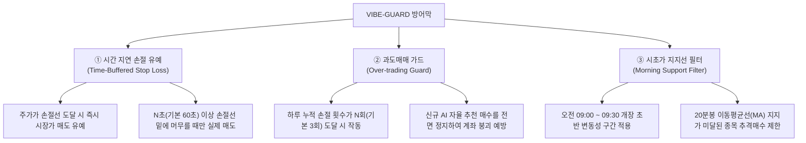

# 🛡️ VIBE-GUARD 기능 사용 및 모니터링 매뉴얼

VIBE-GUARD는 잦은 손절로 인해 누적되는 투자 손실을 근본적으로 차단하기 위해 추가된 **3대 방어 메커니즘**입니다. 기존 시스템의 흐름을 보존하면서 유연하고 안전하게 동작하도록 정교하게 설계되었습니다.

---

## 1. VIBE-GUARD 핵심 기능 요약



---

## 2. 설정 방법 (Configuration)

설정은 프로젝트 루트의 [config.yaml](file:///home/ubuntu/project/ai-tradding/config.yaml) 또는 [trading_state.json](file:///home/ubuntu/project/ai-tradding/trading_state.json)의 `vibe_strategy` 섹션을 통해 동적으로 제어됩니다.

| 설정 항목 | 설명 | 기본값 |
| :--- | :--- | :--- |
| `use_time_buffered_sl` | 시간 지연 버퍼 손절 사용 여부 | `True` |
| `take_profit_time_buffer_sec` | 손절 유예 시간 (초 단위) | `60` (1분) |
| `use_overtrading_guard` | 일일 최대 손절 제한(과도매매 가드) 사용 여부 | `True` |
| `max_daily_sl_count` | 일일 허용 최대 손절 횟수 | `3` (3회) |
| `use_morning_support_filter` | 시초가 지지선 필터(9:30 룰) 사용 여부 | `True` |

---

## 3. 실시간 모니터링 방법 (Monitoring)

VIBE-GUARD의 작동 여부는 터미널 UI(TUI) 대시보드 화면 및 실시간 로그를 통해 완벽히 투명하게 모니터링할 수 있습니다.

### ① TUI 대시보드 모니터링

1. **과도매매 가드(OTG) 모니터링**:
   * 대시보드 중앙의 `SETUP` 라인의 `리스크` 영역에 실시간 손절 카운트가 `[OTG:현재손절횟수/최대허용횟수]` 형태로 상시 표기됩니다.
   * **예**: `[OTG:1/3]` (현재 1회 손절 발생, 3회 제한)
   * 만약 한도(3회)에 도달하면 리스크 등급이 `NORMAL`에서 빨간색 배경의 **`!GUARD(OTG)!`**로 자동 전환되며 신규 AI 매수가 차단 중임을 알립니다.

2. **손절 지연 버퍼 모니터링**:
   * 보유 종목의 주가가 손절선(SL) 밑으로 하향 돌파하여 버퍼가 도달하면, TUI 대시보드 보유 종목 우측의 `잔여(REM)` 컬럼에 만료시간(M) 대신 **노란색 글씨로 남은 유예 초가 표기**됩니다.
   * **예**: `SL:45S` (45초 후에 실제 손절 집행 예정)
   * 주가가 유예 시간 내에 다시 손절선 위로 회복되면 카운트다운이 즉시 사라지고 원래 상태로 복구됩니다.

### ② 실시간 텔레그램 및 텍스트 로그 모니터링
VIBE-GUARD가 트리거되거나 해제될 때, `🛡️ [VIBE-GUARD]` 태그와 함께 명확한 상태 변화 로그가 남습니다.

* **손절 유예 감지 시**:
  ```text
  🛡️ [VIBE-GUARD] 삼성전자(005930) 손절선 이탈 감지: 수익률 -5.20% <= -5.00%. 60초 유예 대기...
  ```
* **유예 시간 중 주가 회복으로 손절 차단 성공 시**:
  ```text
  🛡️ [VIBE-GUARD] 삼성전자(005930) 주가 회복: 수익률 -4.80% > -5.00%. 손절 대기 상태 해제.
  ```
* **과도매매 가드로 신규 추천 매수 스킵 시**:
  ```text
  🛡️ [VIBE-GUARD] 일일 최대 손절 한도 도달로 [000660]SK하이닉스 매수 스킵 (누적 손절: 3/3회)
  ```
* **시초가 이평선 지지 미달로 추격매수 제한 시**:
  ```text
  🛡️ [VIBE-GUARD] 시초가 지지선 미달로 [009150]삼성전기 매수 스킵 (현재가 118,500 <= 20MA 120,000)
  ```

---

## 4. 코드 구현 무결성 검증

* **기존 기능 보존**: 기존의 `RiskManager`, `ExitManager`, `TradeWorker`의 동작 구조를 전혀 훼손하지 않고, 매수 루프 및 매도 판정 로직에 안전한 가드(Guard) 조건식만 추가하는 형태로 탑재되었습니다.
* **주석의 완전성**: [strategy.py](file:///home/ubuntu/project/ai-tradding/src/strategy/vibe/strategy.py), [execution.py](file:///home/ubuntu/project/ai-tradding/src/strategy/vibe/execution.py), [risk_manager.py](file:///home/ubuntu/project/ai-tradding/src/strategy/risk_manager.py) 등 추가 및 수정한 코드 블록마다 기능 설명과 설계 의도를 설명하는 한국어 주석이 촘촘하게 달려 있어 유지보수가 용이합니다.
