# 🛡️ VIBE-GUARD & 리스크 방어 매뉴얼 (v2.4.1)

> [!NOTE]
> 본 문서는 [USER_MANUAL.md](USER_MANUAL.md#️-리스크-관리-및-방어-메커니즘-vibe-guard--5대-손해-축소--수수료-누수-차단-v241-신규)의 리스크 관리 및 방어 메커니즘을 상세히 다루는 특화 가이드입니다. 20거래일 복기 분석에 기반한 **5대 손해 축소 핵심 전략** 및 **하위 종목 수수료 누수 방지 5대 대책**과 연계되어 시스템의 계좌 보존력을 극대화합니다.

---

## 1. 리스크 방어 3중 체계 구조

```mermaid
graph TD
    subgraph 1차: 복기 기반 5대 손해 축소 전략
        A1["① 오프닝 갭 가드 (09:00~09:20 매수동결 & 15분 버퍼)"]
        A2["② 단일 종목 Hard Cap (자산 10% / 800만원 상한)"]
        A3["③ 당일 동일 종목 2회 손절 락 (3시간 쿨다운 & 전면차단)"]
        A4["④ 트레일링 스탑 (+3% 도달 후 1.0%p 반락 시 전량 익절)"]
        A5["⑤ 낙주 필터 (Bear/Neutral 20MA 역배열 음봉 제외)"]
    end

    subgraph 2차: 하위 종목 수수료 누수 및 조기 휩쏘 차단
        B1["① SL Guard 안전마진 (-2.5% 강제 확보로 조기 털림 방지)"]
        B2["② 신규 매수 초기 10분(600초) 호가 노이즈 보호막"]
        B3["③ 자투리 1주 매매(Dust) 금지 & 최소 주문 Floor (30만원)"]
        B4["④ 최소 유동성 거래대금 필터 (30억원 이상)"]
        B5["⑤ 교체 매매(Replacement) 일일 3회 상한"]
    end

    subgraph 3차: 실시간 미시 VIBE-GUARD 방어막
        C1["① 시간 지연 손절 유예 (Time-Buffered SL, 60초)"]
        C2["② 과도매매 가드 (Over-trading Guard, 일일 3회 손절 락)"]
        C3["③ 시초가 지지선 필터 (Morning Support Filter)"]
    end

    A1 --> Engine[자율 트레이딩 실행 엔진]
    A2 --> Engine
    A3 --> Engine
    A4 --> Engine
    A5 --> Engine
    B1 --> Engine
    B2 --> Engine
    B3 --> Engine
    B4 --> Engine
    B5 --> Engine
    C1 --> Engine
    C2 --> Engine
    C3 --> Engine
```

---

## 2. 설정 파라미터 (Configuration)

설정은 프로젝트 루트의 [config.yaml](file:///c:/dev/project/ai-tradding/config.yaml) 또는 [trading_state.json](file:///c:/dev/project/ai-tradding/trading_state.json)의 `vibe_strategy` 및 `risk_manager` 섹션을 통해 동적으로 관리됩니다.

| 설정 항목 | 설명 | 기본값 | 비고 |
| :--- | :--- | :--- | :--- |
| `max_stock_inv_rate` | 단일 종목 투자 한도 비율 | `0.10` (10%) | 총자산 대비 상한 |
| `max_stock_inv_cap` | 단일 종목 투자 절대 상한액 | `8,000,000.0` (800만원) | 대형주 쏠림 방지 |
| `use_time_buffered_sl` | 시간 지연 버퍼 손절 사용 여부 | `True` | 미세 휩소 방지 |
| `take_profit_time_buffer_sec` | 손절 유예 시간 (초 단위) | `60` (1분) | 회복 기회 제공 |
| `use_overtrading_guard` | 일일 최대 손절 제한(과도매매 가드) 사용 여부 | `True` | 계좌 급락 방지 |
| `max_daily_sl_count` | 일일 허용 최대 손절 횟수 | `3` (3회) | 한도 시 신규 매수 차단 |
| `use_morning_support_filter` | 시초가 지지선 필터 사용 여부 | `True` | 09:00~09:30 추격 매수 제한 |
| `min_order_floor` | 1회 신규 매수 최소 주문 금액 기준 | `300,000.0` (30만원) | 자투리 1주 매매 수수료 누수 방지 |
| `min_trading_value` | 최소 유동성 거래대금 기준 | `3,000,000,000.0` (30억원) | 호가 갭/슬리피지 방지 |
| `max_daily_replacements` | 일일 교체 매매(Replacement) 상한 | `3` (3회) | 과도한 Churning 수수료 방지 |

---

## 3. 실시간 모니터링 방법 (TUI & Log)

### ① TUI 대시보드 모니터링
1. **과도매매 가드(OTG)**:
   * 대시보드 중앙 `SETUP` 라인의 `리스크` 영역에 `[OTG:현재손절/3]` 형태로 실시간 카운트 표기.
   * 3회 도달 시 리스크 등급이 빨간색 배경의 **`!GUARD(OTG)!`**로 자동 전환되며 신규 AI 매수 차단.
2. **손절 지연 버퍼**:
   * 주가가 손절선(SL) 밑으로 내려가면 보유 종목 우측 `잔여(REM)` 컬럼에 **`SL:45S`**와 같이 남은 초 카운트다운 표시.
   * 주가가 유예 시간 내에 다시 반등하면 카운트다운이 해제되고 정상 상태 복구.
3. **오프닝 갭 가드 & 트레일링 스탑**:
   * 09:00~09:20 동안 헤더 상태창에 `오프닝 갭 가드 작동 중` 표기.
   * 트레일링 스탑 집행 시 로그에 `🎯 트레일링스탑: 고점 대비 1.0%p 반락 익절` 즉시 표시.
4. **신규 매수 초기 10분 보호**:
   * 매수 직후 10분간 호가 출렁임에 의한 조기 손절을 방지하며 `🛡️ [매수 직후 초단기 보호]` 로그 기록.

### ② 실시간 로그 모니터링
* `🛡️ [오프닝 갭 가드] 09:00~09:20 시초가 변동성 구간 신규 자율 매수 동결`
* `🛡️ [당일 2회 손절 락] 종목[005930] 당일 2회 손절 도달로 오늘 매수 전면 금지`
* `🎯 [트레일링스탑] 종목[000660] 최고수익률 +5.2% -> 현재 +4.1% (1.1%p 하락) 전량 매도`
* `🛡️ [매수 직후 초단기 보호] 종목[005930] 매수 후 10분 이내 (경과 240초/600초). 손절 유예`
* `🛡️ [주문 스킵] 계산된 주문 금액(150,000원)이 최소 주문 한도(300,000원)에 미달하여 매수 취소 (자투리 매매 방지)`
* `🛡️ [유동성 부족] 종목[XXXXXX] 당일 거래대금(18.5억원)이 30억원에 미달하여 자동 매수 제외`
* `🛡️ [VIBE-GUARD] 삼성전자(005930) 손절선 이탈 감지: 수익률 -5.20% <= -5.00%. 60초 유예 대기...`

---

## 4. 관련 문서
* 전체 시스템 매뉴얼: [USER_MANUAL.md](USER_MANUAL.md)
* 기술 아키텍처 명세: [SYSTEM_ARCH.md](SYSTEM_ARCH.md)
* 로직 트리 명세: [LOGIC_TREE.md](LOGIC_TREE.md)
