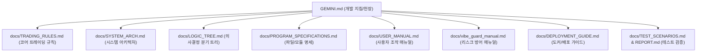

# 📄 GEMINI.md (AI-Vibe-Trader Project Instruction & Guidelines)

> **문서 목적:** 본 문서는 AI 어시스턴트(Antigravity, Gemini 등)가 AI-Vibe-Trader 프로젝트에서 코딩, 디버깅, 리팩토링 및 유지보수를 수행할 때 **반드시 준수해야 하는 최상위 개발 헌장 및 행동 지침서**입니다.

---

## 1. 프로젝트 정체성 및 7대 핵심 아키텍처

*   **프로젝트명**: AI-Vibe-Trader
*   **목표**: 시니어 아키텍트의 설계 사상이 반영된 객체지향형 자율 트레이딩 엔진.
*   **7대 핵심 엔진 (Core Engines)**:
    1.  `MarketAnalyzer`: 글로벌 매크로 지수 및 지수 DEMA 기반 시장 분위기(VIBE) 진단.
    2.  `VibeAlphaEngine`: 네이버 모바일 공식 JSON API 퀀트 분석 및 AI 기반 주도주 발굴.
    3.  `ExitManager`: 실시간 VIBE/Phase 동적 TP/SL 산출, SL Guard 및 트레일링 스탑.
    4.  `RecoveryEngine`: 하락장 자산 보호 및 평단가 관리(물타기).
    5.  `PyramidingEngine`: 상승 추세 종목 이익 극대화(불타기).
    6.  `PresetStrategyEngine`: KIS 공식 10대 전략 맞춤형 할당 및 시뮬레이션.
    7.  `RetrospectiveEngine`: 장 마감 후 매매 성과 복기 및 당일 전체 통계 영속화.

---

## 2. AI 어시스턴트 필수 준수 정책 (Non-Negotiable Policies)

### 💬 응답 및 커뮤니케이션 정책
*   **한국어 원칙**: 모든 설명, 분석, 사용자 응답, 커밋 메시지 요약은 반드시 **한국어**로 작성합니다.
*   **간결하고 명확한 보고**: 변경의 기술적 이유, 비즈니스 영향, 검증 결과를 요약하여 직관적으로 전달합니다.

### 🖥️ OS 및 쉘(Shell) 명령어 실행 정책
*   **사전 환경 확인 필수**: 사용자 환경은 **Windows / PowerShell (pwsh)** 환경입니다.
*   **문법 주의**: PowerShell 환경에서 `&&` 연산자는 구문 오류를 발생시키므로 **절대 사용하지 않고 명령어를 개별 분리 실행**합니다.
*   **경로 표기**: 파일 경로 및 터미널 명령어 실행 시 Windows 경로 규칙(`\`)과 PowerShell 문법을 준수합니다.

### 🏦 브로커 듀얼 지원 정책 (Dual Brokerage Support)
*   **KIS & Kiwoom 동시 지원**: 모든 트레이딩 기능 개발 시 **한국투자증권(KIS API)**과 **키움증권(Kiwoom API)**을 동등하게 지원해야 합니다.
*   **인터페이스 일관성**: 한쪽 브로커에만 편향된 로직을 지양하고, API 클라이언트(`kis.py`, `kiwoom.py`)의 입출력 데이터 구조와 시그니처 정합성을 엄격히 유지합니다.

### 🖥️ UI 안정성 및 모니터링 정책
*   **Atomic Swap 정책**: 백그라운드 AI 분석(시황, 추천) 중에는 기존 데이터를 UI에 그대로 유지하고, 분석 완료 시점에 일괄 원자적 교체(Atomic Swap)하여 화면 깜빡임이나 공란 발생을 원천 차단합니다.
*   **모니터링 주기 가시화**: `L` 키 시스템 모니터링 테이블의 `시간 | 주기 | 경과` 컬럼 체계를 항상 유지합니다.
*   **타임존 표준화**: 모든 로그 및 모니터링 시각 표기는 한국 표준시(`KST, Asia/Seoul`)를 명시적으로 적용합니다.

---

## 3. 단일 진실 공급원(SSOT) 문서 체계 맵

모든 상세 기술 명세는 각 전용 문서에 집중 관리되며, AI는 작업을 수행할 때 해당 문서를 단일 진실 공급원으로 참조합니다.



| 문서 경로 | 담당 영역 및 참조 시점 |
| :--- | :--- |
| **`docs/TRADING_RULES.md`** | **[코어 매매 규칙]** 동적 TP/SL 수치, Vibe/Phase 보정, 물타기/불타기 조건, 복기 기반 5대 손해 축소 전략, 하위 종목 수수료 방어 대책, 10대 프리셋 명세 |
| **`docs/SYSTEM_ARCH.md`** | **[시스템 구조]** 고수준 아키텍처, 7대 코어 모듈 다이어그램, 계층별 데이터 흐름 |
| **`docs/LOGIC_TREE.md`** | **[로직 분기]** 세부 의사결정 분기 조건문, 플로우차트, 유지보수 히스토리 |
| **`docs/PROGRAM_SPECIFICATIONS.md`**| **[프로그램 명세]** `src/` 내 전수 파이썬 파일 목록 및 각 모듈별 상세 역할 정의 |
| **`docs/USER_MANUAL.md`** | **[사용자 가이드]** TUI 화면 구성, 전체 단축키 맵, 설정 파라미터 조작법 |
| **`docs/vibe_guard_manual.md`** | **[리스크 가이드]** 3중 방어 메커니즘, 과도매매 가드(OTG), 지연 손절 유예 상세 |
| **`docs/DEPLOYMENT_GUIDE.md`** | **[도커/배포]** Docker 컨테이너 빌드/실행, GitHub Actions CI/CD 파이프라인 |
| **`docs/TEST_SCENARIOS.md`** | **[테스트 명세]** 64종 통합/단위 테스트 케이스 명세 및 검증 기준 |
| **`docs/TEST_REPORT.md`** | **[테스트 리포트]** 테스트 통과 결과 및 무결성 검증 이력 |

---

## 4. 개발 및 수정 시 필수 워크플로우

주요 기능 추가, 버그 수정, 리팩토링 시 아래 4단계를 예외 없이 준수해야 합니다.

### 1단계: 설계 정합성 사전 검토
*   트레이딩 로직 변경 시 `docs/TRADING_RULES.md` 및 `docs/LOGIC_TREE.md`의 기존 규칙과 충돌 여부를 먼저 확인합니다.

### 2단계: 소스 코드 구현 및 안전성 가드
*   **중앙 API Rate Limiting**: 모든 브로커 API 호출 시 Token Bucket 속도 제한을 준수합니다.
*   **Safe-Check & Fallback**: 지표 계산 시 데이터 누락(0원 수신, NaN 등)에 대한 예외 처리를 격리합니다.
*   **영속성 동기화**: 거래 상태 및 전략 설정 변경 시 `trading_state.json`에 즉각 반영합니다.

### 3단계: 테스트 전수 검증 (Regression Zero)
*   수정 후 반드시 아래 명령어로 **전체 테스트(71개 이상)**를 실행하여 100% 통과(Pass)를 확인합니다.
    ```powershell
    .\.venv\Scripts\pytest -v
    ```

### 4단계: 문서 통합 최신화 (Documentation Sync)
*   **파일 목록 동기화**: `src/` 내 파일이 추가/삭제/이동된 경우 아래 명령어를 실행하여 `docs/PROGRAM_SPECIFICATIONS.md`를 갱신합니다.
    ```powershell
    Get-ChildItem -Path src -Filter *.py -Recurse | Resolve-Path -Relative
    ```
*   **관련 문서 일괄 반영**: 변경 사항의 성격에 따라 `docs/TRADING_RULES.md`, `docs/LOGIC_TREE.md`, `docs/USER_MANUAL.md`, `docs/TEST_SCENARIOS.md`, `docs/TEST_REPORT.md`를 반드시 함께 최신화합니다.
